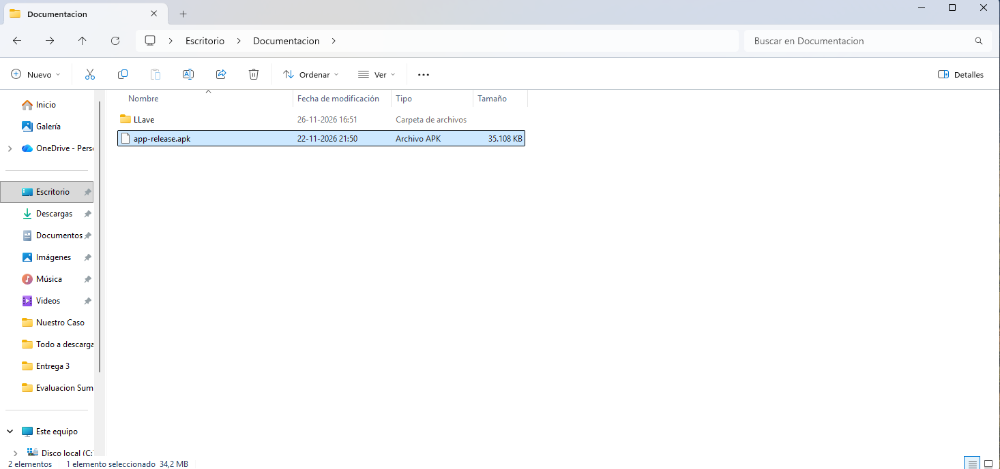
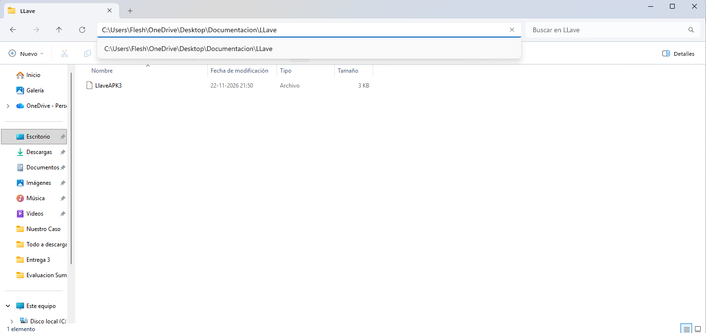

# MACMovilCare (MCmovil Care)


## 1. Nombre del proyecto y descripción

**MACMovilCare** (marca en la interfaz: **MCmovil Care – Soporte Técnico Especializado**) es una aplicación móvil Android para la **gestión de órdenes de trabajo de un taller de reparación y soporte técnico de equipos**, acompañada de un **microservicio REST propio** (Node.js + Express + SQLite).

**Problema que resuelve:** digitaliza todo el ciclo de atención de un equipo en el taller, reemplazando el seguimiento manual (papel, llamadas o mensajes sueltos):

> Ingreso de la solicitud → Diagnóstico y cotización del técnico → Autorización del cliente → Reparación → Retiro seguro mediante código QR

La app trabaja con **tres roles** (Cliente, Técnico y Administrador), cada uno con su propia vista y permisos. El cliente conoce el estado de su equipo y autoriza el presupuesto desde el teléfono; el técnico gestiona diagnósticos, cotizaciones y evidencias; el administrador supervisa y controla todas las órdenes.

| Dato | Detalle |
|------|---------|
| Asignatura | Desarrollo de Aplicaciones Móviles — Cuarto Semestre |
| Docente / Sección | `[Miguel jesus Acevedo Cadiz]` / `[003D]` |
| Repositorio | https://github.com/mabricenos-design/App-Moviles-003D (rama `MacMovilV3`) |
| Paquete Android | `com.example.macmovilcare` |
| Versión | 1.0 (`versionCode` 1) |

### Arquitectura y estructura

La app sigue el patrón **MVVM + Repository**, con **Room como fuente única de verdad** (funcionamiento con respaldo local si el microservicio no responde).

```text
App-Moviles-003D/
├── app/                                   # Aplicación Android (Kotlin + Jetpack Compose)
│   └── src/
│       ├── main/java/com/example/macmovilcare/
│       │   ├── MainActivity.kt
│       │   ├── navigation/AppNavigation.kt   # NavHost: login, home, crear_solicitud, detalle/{ordenId}
│       │   ├── model/                        # OrdenTrabajo, EstadoOrden, Usuario/RolUsuario, Cotizacion, Evidencia...
│       │   ├── data/
│       │   │   ├── local/                    # Room (AppDatabase, OrdenesDao, OrdenEntity) + DataStore (UserPreferences)
│       │   │   ├── remote/                   # Retrofit (ApiService, Indicadores), RetiroQrApiService, DTOs
│       │   │   └── repository/MCmovilRepository.kt
│       │   ├── viewmodel/                    # AuthViewModel, OrdenesViewModel, SolicitudViewModel
│       │   └── ui/                           # screens/, components/, theme/
│       ├── test/                             # Pruebas unitarias (JUnit4 + MockK + coroutines-test)
│       └── androidTest/                      # Prueba instrumentada de ejemplo
├── mcmovilbackend/                        # Microservicio Node.js + Express + SQLite
│   ├── server.js
│   ├── package.json
│   └── mcmovil_backend.db                 # Base SQLite (se crea y siembra automáticamente)
├── build.gradle.kts · settings.gradle.kts · gradle.properties
└── gradlew · gradlew.bat
```

---

## 2. Integrantes

| N° | Nombre completo | Usuario GitHub | Rol en el equipo | Aportes registrados en Git (referencia) |
|----|-----------------|----------------|------------------|------------------------------------------|
| 1 | `Martin Briceño` | `Fleshtling` | `[Rol: Desarrollador Backend / QA]` | Integración de la API del dólar en tiempo real, persistencia del último valor, dependencias y pruebas unitarias |
| 2 | `Sayri Sepulveda` | `sayrsepulveda-jpg` | `[Rol: Desarrollador Android / UI]` | Registro de solicitudes, cotización del técnico, captura de cámara, funciones de administrador, login por rol e integración del QR |


---

## 3. Funcionalidades

### 3.1 Autenticación y roles
- Pantalla de **inicio de sesión** con correo y contraseña (con opción de mostrar/ocultar contraseña).
- Validación de formato: el correo debe contener `@` y un nombre antes de él.
- El **rol se detecta por el dominio del correo** y se valida la contraseña correspondiente (credenciales de demostración):

| Rol | Correo (dominio) | Contraseña |
|-----|------------------|------------|
| Cliente | `nombre@cliente.com` | `cliente123` |
| Técnico | `nombre@tecnico.com` | `tecnico123` |
| Administrador | `nombre@admin.com` | `admin123` |

- Mensajes de error específicos (dominio no permitido o contraseña incorrecta por perfil).
- El nombre mostrado en la cabecera (*"Bienvenido, {nombre}"*) se obtiene del correo ingresado.
- **Cerrar sesión** desde la barra superior; vuelve al login y limpia el back stack.

### 3.2 Vista Cliente — *"Mis Equipos" / Portal de Cliente*
- Listado de órdenes con **insignias de estado** de color (Ingresado, En Diagnóstico, Cotizado, Aprobado, Rechazado, En Reparación, Listo p/ Entrega, Entregado).
- Sección destacada **"Cotizaciones por Autorizar (n)"** para las órdenes en estado `COTIZADO_PENDIENTE`, y sección **"Historial de Órdenes"** para el resto.
- **Nueva Solicitud** (botón flotante): formulario con *ID o N° de serie del equipo* y *descripción del problema o falla*, con validación de campos obligatorios. Al enviar:
  - se registra la orden en el microservicio (`POST /api/ordenes`) y se guarda en Room;
  - si no hay conexión con la API, la orden se guarda **localmente** como respaldo;
  - se dispara un aviso interno para el técnico.
- **Detalle de la orden:** equipo, fecha de ingreso, diagnóstico y comentarios del técnico, cotización (monto en **CLP** y referencia en **USD** según el dólar del día) y estado de autorización.
- **Aprobar y Generar QR / Rechazar** la cotización. Al aprobar se actualiza el estado en el microservicio y se genera el **pase digital QR de retiro**.

### 3.3 Vista Técnico — *"Taller Técnico" / Órdenes Asignadas*
- Ve únicamente las órdenes en estados `INGRESADO`, `EN_DIAGNOSTICO`, `COTIZADO_PENDIENTE`, `APROBADO` y `EN_REPARACION`. Las solicitudes nuevas se marcan como *"Nueva solicitud · Equipo #…"*.
- **Banner "Nueva Solicitud Recibida"** con el equipo y la descripción enviada por el cliente (descartable con *"Listo"*).
- **Elaborar Cotización y Diagnóstico** (órdenes `INGRESADO` / `EN_DIAGNOSTICO`):
  - diagnóstico técnico de la falla;
  - monto de la cotización en CLP, con **vista previa de la conversión a USD** (*"Dólar hoy: $… CLP · Equivalente: US$ …"*);
  - detalle de repuestos y servicios;
  - **evidencia fotográfica** desde **cámara** (solicita permiso de cámara en tiempo de ejecución) o **galería**, con vista previa;
  - validaciones: diagnóstico y detalle no vacíos y monto numérico mayor que 0.
  - **Enviar Cotización al Cliente**: envía la cotización al microservicio (`POST /api/ordenes/{id}/cotizacion`) y deja la orden en `COTIZADO_PENDIENTE`.
- **Escanear QR Retiro** (botón flotante): abre un escáner con **CameraX + ML Kit** para leer el QR que muestra el cliente. La validación comprueba:
  1. que el QR pertenezca a MCmovil Care (`MCMOVIL|{ordenId}|{token}`);
  2. que el token de seguridad coincida con el de la orden;
  3. que el QR **no haya sido utilizado antes** (consulta el estado en la nube).
  Si todo es correcto, la orden pasa a **`ENTREGADO`** y se muestra el mensaje *"Retiro aprobado con éxito para Orden #… (Estado: ENTREGADO)"*; en caso contrario se informa el motivo del error.

### 3.4 Vista Administrador — *"Panel Global" / Administración de Taller*
- **Indicadores (KPI):** Total, Pendientes, En Taller y Listos.
- **Filtros por estado** (chips con contador por cada estado y opción *"Todos"*).
- **Eliminar órdenes** desde el listado o desde el detalle, con diálogo de confirmación (elimina en el microservicio y en la base local).
- **Cambiar manualmente el estado** de cualquier orden desde el detalle (menú desplegable con todos los estados).

### 3.5 Pase digital QR de retiro
- Al aprobar la cotización, el cliente obtiene un **código QR** (imagen generada por API en línea) con el formato `MCMOVIL|{ordenId}|{token}`.
- El token se calcula de forma determinística por orden (`MCMOVIL2026-{ordenId}`) y el estado del ticket (aprobado / retirado) se **sincroniza en la nube entre los dos teléfonos** (cliente y técnico).
- Cuando el técnico valida el retiro, el pase del cliente muestra *"Equipo retirado y validado exitosamente por el técnico"*.

### 3.6 Conversión de moneda en tiempo real
- Consulta el **valor del dólar** a una API pública y lo usa para mostrar el equivalente en USD de cada cotización.
- El último valor se guarda en `SharedPreferences` (`mcmovil_cache`) para uso **sin conexión** (valor por defecto: 950 CLP) y se actualiza automáticamente cuando el dispositivo **recupera la conectividad**.

### 3.7 Persistencia y funcionamiento sin conexión
- **Room** (`macmovil_care.db`, tabla `ordenes_trabajo`): almacena las órdenes y las expone como `Flow`; la UI se actualiza automáticamente.
- **Sincronización:** al iniciar, se descargan las órdenes del microservicio y se guardan en Room. Si la base está vacía se cargan 2 órdenes de prueba (101 y 102).
- **Respaldo local:** si la API falla al crear una solicitud, enviar una cotización o cambiar un estado, la operación se aplica igualmente en Room.
- **DataStore** (`UserPreferences`): clase para guardar y limpiar la sesión (`usuario_id`, `usuario_rol`).

### 3.8 Recursos nativos y calidad
- Permisos declarados: cámara, lectura de imágenes, notificaciones, internet y estado de red.
- Navegación con **Navigation Compose** (`login`, `home`, `crear_solicitud`, `detalle/{ordenId}`).
- Interfaz con **Material 3** y tema propio.
- **Pruebas unitarias** (JUnit4, MockK, coroutines-test): 8 pruebas del repositorio (sincronización, manejo de errores sin internet, login, creación de solicitud, cotización, aprobación y eliminación) y 5 pruebas del `OrdenesViewModel` (carga desde Room, dólar desde API externa, selección de orden, notificación y cotización con evidencia).

---

## 4. Endpoints utilizados

### 4.1 Microservicios propios

**Microservicio `mcmovilbackend`** (Node.js + Express + SQLite).
- URL base local: `http://localhost:8080/api/`
- Desde el emulador Android: `http://10.0.2.2:8080/api/` (configurado en `RetrofitClient.kt`).
- Todas las respuestas son JSON. La app envía `Authorization: Bearer <token>` en las operaciones de escritura (el microservicio actual no valida este encabezado).

| Método | Endpoint | Descripción | Parámetros / Body esperados | Respuesta |
|--------|----------|-------------|-----------------------------|-----------|
| `POST` | `/api/auth/login` | Devuelve un token y el rol. Asigna `TECNICO` si el correo contiene "tecnico"; en otro caso `CLIENTE`. No valida la contraseña. | Body: `{ "correo": string, "clave": string }` | `200` → `{ "token", "usuarioId", "rol", "mensaje" }` |
| `GET` | `/api/ordenes` | Lista todas las órdenes de trabajo. | — | `200` → arreglo de órdenes |
| `GET` | `/api/usuarios/:id` | Devuelve un usuario de ejemplo con el id indicado. | Path: `id` | `200` → `{ "id", "nombre", "correo" }` |
| `POST` | `/api/ordenes` | Crea una nueva solicitud. Genera un ID alfanumérico de 6 caracteres. | Body: `{ "equipoId": string, "clienteId"?: string (def. "CLI-01"), "fechaIngreso": string, "estado"?: string (def. "INGRESADO"), "diagnostico": string }` | `201` → orden creada |
| `POST` | `/api/ordenes/:id/cotizacion` | Registra el diagnóstico y el monto de la cotización; deja la orden en `COTIZADO_PENDIENTE`. | Path: `id`. Body: `{ "diagnostico": string, "montoTotal": number, "detallesServicios": string }` | `200` → orden actualizada · `404` → `{ "detail": "Orden no encontrada" }` |
| `PUT` | `/api/ordenes/:id/estado` | Actualiza el estado de la orden. Si `nuevoEstado` es `APROBADO`, se guarda como `EN_REPARACION`. | Path: `id`. Body: `{ "nuevoEstado": string }` | `200` → orden actualizada · `404` → `{ "detail": "Orden no encontrada" }` |
| `DELETE` | `/api/ordenes/:id` | Elimina una orden. | Path: `id` | `200` → `{ "mensaje": "Orden eliminada" }` |

**Uso desde la app (`ApiService.kt`):**

| Endpoint | Función Retrofit | Se usa en |
|----------|------------------|-----------|
| `GET /ordenes` | `obtenerOrdenes()` | Sincronización inicial de órdenes |
| `POST /ordenes` | `crearSolicitud()` | Nueva solicitud del cliente |
| `POST /ordenes/{id}/cotizacion` | `generarCotizacion()` | Respuesta del técnico |
| `PUT /ordenes/{id}/estado` | `actualizarEstadoOrden()` | Aprobar/rechazar cotización y cambio de estado por el administrador |
| `DELETE /ordenes/{id}` | `eliminarOrden()` | Eliminación por el administrador |
| `POST /auth/login` | `login()` | Declarado en el repositorio; la pantalla de login actual valida las credenciales de demostración de forma local |
| `GET /usuarios/{id}` | `obtenerUsuario()` | Declarado en `ApiService`; sin uso en las pantallas actuales |

**Modelo de datos del microservicio (tabla `ordenes`, SQLite):**

| Campo | Tipo | Observación |
|-------|------|-------------|
| `id` | TEXT (PK) | Autogenerado al crear |
| `equipoId` | TEXT | ID o N° de serie del equipo |
| `clienteId` | TEXT | Por defecto `CLI-01` |
| `fechaIngreso` | TEXT | Formato `dd-MM-yyyy` |
| `estado` | TEXT | `INGRESADO`, `EN_DIAGNOSTICO`, `COTIZADO_PENDIENTE`, `APROBADO`, `RECHAZADO`, `EN_REPARACION`, `LISTO_PARA_ENTREGA`, `ENTREGADO` |
| `diagnostico` | TEXT | Diagnóstico técnico |
| `montoTotal` | REAL | Monto de la cotización (por defecto 0) |
| `detalleServicios` | TEXT | Detalle de repuestos y servicios |

Datos iniciales (si la tabla está vacía): órdenes `101` (EQ-550, `COTIZADO_PENDIENTE`) y `102` (EQ-720, `INGRESADO`).

### 4.2 APIs externas

| API | Endpoint consumido | Método | Propósito dentro de la app | Implementación |
|-----|--------------------|--------|-----------------------------|----------------|
| **mindicador.cl** (indicadores económicos de Chile, sin API key) | `https://mindicador.cl/api` | `GET` | Obtener el valor del **dólar** (`dolar.valor`) para convertir las cotizaciones de CLP a USD | `RetrofitIndicadoresClient`, `IndicadoresApiService`, `OrdenesViewModel.cargarValorDolar()` |
| **QuickChart** (generador de QR en línea) | `https://quickchart.io/qr?text={payload}&size=350&margin=2&dark=0f2624&light=ffffff` | `GET` | Generar la **imagen del código QR** de retiro (`payload = MCMOVIL\|{ordenId}\|{token}`), que se carga con Coil | `RetiroQrApiService.construirUrlImagenQr()` |
| **ntfy.sh** (mensajería pub/sub pública, sin registro) | `https://ntfy.sh/mcmovilcare_sync_orden_{ordenId}` | `POST` | **Publicar** el estado del ticket de retiro (aprobado por el cliente / retiro confirmado) para sincronizar ambos teléfonos | `RetiroQrApiService.registrarAprobacionYGenerarTicket()` y `validarYConfirmarRetiroPorQr()` |
| **ntfy.sh** | `https://ntfy.sh/mcmovilcare_sync_orden_{ordenId}/json?poll=1` | `GET` | **Consultar** el último estado publicado del ticket (evita reutilizar un QR ya canjeado y actualiza el pase del cliente) | `RetiroQrApiService.consultarTicketRemoto()` |

> Cuerpo publicado en ntfy.sh (`text/plain`): `{ "ordenId", "tokenRetiro", "aprobadoPorCliente", "retiradoConfirmado" }`.

---

## 5. Pasos para ejecutar

### 5.1 Prerrequisitos

| Herramienta | Versión / Detalle |
|-------------|-------------------|
| Android Studio | Compatible con AGP 8.7.2 (Ladybug 2024.2.1 o superior) |
| JDK | El wrapper usa la toolchain definida en `gradle/gradle-daemon-jvm.properties` (JDK 25, descarga automática); el código compila con target Java 11 |
| Gradle | 9.6.0 (incluido vía `gradlew`, no requiere instalación) |
| Android SDK | Plataforma 35 (`compileSdk 35`); dispositivo/emulador con Android 7.0 (API 24) o superior |
| Node.js + npm | Node.js **22.13 o superior** (el microservicio usa el módulo nativo `node:sqlite`) |
| Git | Para clonar el repositorio |
| Cámara | Necesaria solo para probar el escaneo de QR y la captura de evidencias |

**Variables de entorno:** no se requieren. El microservicio escucha en el puerto `8080` (definido en `server.js`) y la dirección de la API se configura en `RetrofitClient.kt`.

### 5.2 Clonar el proyecto

```bash
git clone https://github.com/mabricenos-design/App-Moviles-003D.git
cd App-Moviles-003D
git checkout MacMovilV3
```

### 5.3 Levantar el microservicio

```bash
cd mcmovilbackend
npm install
npm start
```

Salida esperada:

```text
✅ Microservicio MCmovil Care activo en http://localhost:8080/api/
```

Al primer arranque se crea (o reutiliza) el archivo `mcmovil_backend.db` con las órdenes de ejemplo. Verificación rápida:

```bash
curl http://localhost:8080/api/ordenes
```

> En PowerShell usa `curl.exe` (o `Invoke-RestMethod`), o prueba los endpoints con Postman / Thunder Client.

### 5.4 Configurar y ejecutar la app Android

1. Abre la **carpeta raíz del proyecto** en Android Studio y espera a que termine el *Gradle Sync* (el archivo `local.properties` con la ruta del SDK se genera automáticamente).
2. **Dirección del microservicio** (`app/src/main/java/com/example/macmovilcare/data/remote/RetrofitClient.kt`):
   - **Emulador Android:** ya está configurado en `http://10.0.2.2:8080/api/` (alias del `localhost` del PC).
   - **Teléfono físico:** reemplaza `BASE_URL` por la IP local del PC, por ejemplo `http://192.168.1.50:8080/api/` (misma red Wi-Fi y puerto 8080 permitido en el firewall).
3. **Tráfico HTTP:** el microservicio se consume por HTTP (sin TLS). Como Android 9+ bloquea el tráfico no cifrado por defecto, para desarrollo agrega en `AndroidManifest.xml`, dentro de `<application>`:

   ```xml
   android:usesCleartextTraffic="true"
   ```
4. Selecciona un emulador o dispositivo y pulsa **Run ▶** (configuración `app`).
5. Inicia sesión con las credenciales de la sección 3.1 y prueba el flujo completo:
   1. **Cliente:** *Nueva Solicitud* → ingresar equipo y falla.
   2. **Técnico:** abrir la solicitud → *Elaborar Cotización* → *Enviar Cotización al Cliente*.
   3. **Cliente:** abrir la cotización → *Aprobar y Generar QR*.
   4. **Técnico:** *Escanear QR Retiro* y apuntar al QR del cliente (idealmente con dos dispositivos) → la orden pasa a `ENTREGADO`.
   5. **Administrador:** revisar KPIs, filtrar por estado, cambiar estados o eliminar órdenes.

> Si el microservicio no está disponible, la app sigue funcionando con los datos locales (Room).

### 5.5 Ejecutar las pruebas unitarias

```bash
./gradlew test          # Linux / macOS
gradlew.bat test        # Windows
```

### 5.6 Generar el APK

**APK de depuración:**

```bash
./gradlew assembleDebug
# Salida: app/build/outputs/apk/debug/app-debug.apk
```

**APK firmado (release):** en Android Studio ir a **Build ▸ Generate Signed App Bundle / APK… ▸ APK**, seleccionar el archivo de llave (keystore), indicar *alias* y contraseñas, elegir la variante **release** y finalizar. El resultado queda en:

```text
app/release/app-release.apk
```

Instalación en un dispositivo conectado por USB:

```bash
adb install app/release/app-release.apk
```

---

## 6. Evidencias y entregables

### 6.1 APK firmado

| Característica | Valor |
|----------------|-------|
| Archivo | `app-release.apk` |
| Tamaño | 35.108 KB (≈ 34,3 MB) |
| Fecha de generación | 22-11-2026 21:04 |
| Ubicación en el proyecto | `app/release/app-release.apk` |
| Identificador de la app | `com.example.macmovilcare` |
| Versión | 1.0 (`versionCode` 1) |
| SDK mínimo / objetivo | 24 / 35 |
| Plugin de Android Gradle | 8.7.2 |
| Firma | Esquema de firma de APK v3 (bloque de firma presente en el archivo) |

Verificación de la firma (herramienta `apksigner` de las *build-tools* del Android SDK):

```bash
apksigner verify --verbose --print-certs app-release.apk
```

### 6.2 Archivo keystore (`.jks`)

| Característica | Valor |
|----------------|-------|
| Archivo | `LlaveAPK3` (keystore de firma, formato PKCS12) |
| Alias de la llave | `[LlaveAPK3]` |
| Uso | Firma del APK de release |

> ⚠️ **Seguridad:** el keystore y sus contraseñas **no deben subirse al repositorio ni documentarse** en este archivo. Se entrega únicamente la evidencia de su existencia.
>
> **Captura del APK firmado (`app-release.apk`):**



**Captura del archivo `.jks` (keystore):**



### 6.3 Planificación en Trello

- **Tablero de Trello:** [`[Aplicacion Movil]`](https://trello.com/b/bySLjXry/aplicacionmovil)

---

<p align="center">MACMovilCare · Desarrollo de Aplicaciones Móviles · 2026</p>
